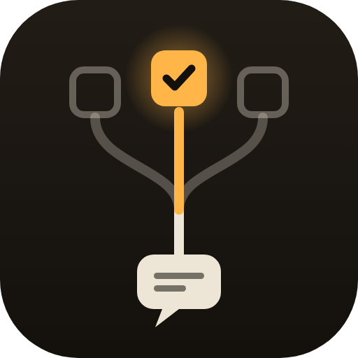
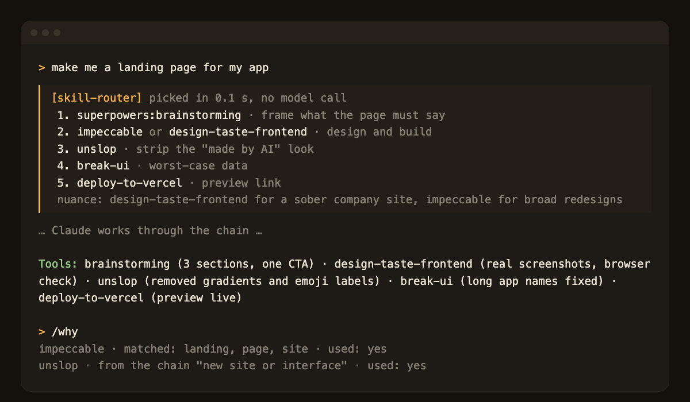

<p align="center"></p>

# skill-router

**Your Claude Code agent has 100+ skills, plugins and MCP servers. It uses three.**
skill-router picks the right ones for every message, hands them to Claude in the order a pro would use them,
and Claude ends each answer with one line saying what each tool brought.

<p align="center"></p>
<p align="center"><sub>Illustration: the exact list depends on the tools you have installed.</sub></p>

## Install

```bash
claude plugin marketplace add Fripouilledu92/skill-router
claude plugin install skill-router@skill-router
```

Open a new Claude Code session. Your tools are classified once in the background, then every message is routed
locally in about 0.1 s, with no model call.

## How it works

| When | What happens | Cost |
|---|---|---|
| Install / new session | Every skill, agent, command, plugin and **connected** MCP server is listed. New or changed ones are classified once, in the background, by Claude: category, tags, specialty, phase, neighbors. | One `claude -p` call per batch of new tools, once |
| Every message | A local script (no model call) scores your message against the index and gives Claude a shortlist, the usual chain for that kind of task, and the nuances between similar tools. | 0 model calls, ~250-400 tokens of context, ~0.1 s |
| Claude answers | Claude keeps the tools that really help, uses them in order (frame → design → build → verify → ship) and ends with a `Tools:` line. | — |
| After the answer | It notes which proposed tools were actually used; useful ones climb, ignored ones sink a little. | 0 |

**Neighbors, not duplicates.** Two design skills are not the same skill. Each tool carries a specialty and a
"when to pick me over my neighbor" nuance, so Claude chooses `unslop` to clean an AI-looking screen and
`impeccable` to design one from scratch.

**Only what is connected.** MCP servers that need auth or failed to start are ignored (`claude mcp list`).

**Quiet on small talk.** "ok", "thanks", "continue" and slash commands trigger nothing.

## Commands

| Command | What it does |
|---|---|
| `/why` | Why these tools were proposed for the last message, which words matched, which were really used |
| `/skills-map` | Your whole toolbox, by category, with security notes |
| `/skills-off <name>` · `/skills-off on <name>` | Never propose a tool again / bring it back |
| `/skills-sync` | Classify new tools now, including the ones only the agent can see (desktop app connectors) |

## Requirements

Claude Code, Python 3.9+, the `claude` CLI on your PATH. The first classification of ~150 tools takes a few
minutes in the background; until then tools are matched on their raw descriptions.

## Settings

`~/.claude/skill-router/prefs.json`:

```json
{ "max": 5, "modele": "sonnet", "langue": "english", "classement_auto": true, "off": [] }
```

## Fixing a classification

Anything the automatic classification got wrong goes in `~/.claude/skill-router/corrections.json`. Corrections
always win over the classifier and survive re-classification:

```json
{
  "categories": { "Old name": "New name" },
  "items": { "skill:unslop": { "phase": "verifier", "specialite": "…" } },
  "recettes": { "Design": [ { "quand": "…", "mots": ["site"], "chaine": ["skill:a", "skill:b|skill:c", "skill:d"] } ] }
}
```

`"skill:b|skill:c"` in a chain means "one of these, pick by the nuances".

## Security

- Classification only **reads** tool files. It never runs a skill's scripts.
- Each tool gets an `alerte` field when it sends data out, publishes, spends money or touches your config;
  `/skills-map` shows them.
- The router only ever *suggests*. Your permission settings still apply to everything Claude does.

## Limits (v0.1)

- Claude Code only. Codex, Cursor and Gemini CLI adapters are planned.
- claude.ai on the web has no hooks, so it cannot run there automatically.
- Matching is lexical (with FR/EN synonyms) for speed and zero cost: it builds a generous shortlist and lets
  Claude make the final call.
- Learning ignores claude.ai connectors (their tool names are opaque ids).

## Tests

The cases are examples from the author's own setup: they check the router against *your* index
(`~/.claude/skill-router/index.json`), so adapt `tests/cas.json` to the tools you have.

```bash
python3 tests/evaluer.py               # labelled cases used while tuning
python3 tests/evaluer.py tests/cas-inedits.json   # cases written after tuning
```

---

**En français** : à chaque message, skill-router choisit les skills, plugins et serveurs MCP connectés qui servent
la demande, les donne à Claude dans l'ordre, et Claude termine sa réponse par une ligne « Outils : … ». Le tri se
fait une fois à l'installation et à chaque ajout ; l'analyse de chaque message est locale et ne coûte aucun appel
au modèle.

MIT License.
